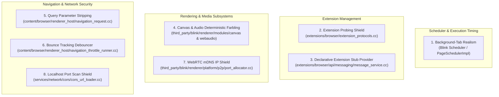

# Implementation Plan: JithuBrowser Release 2

**Target Project:** JithuBrowser  
**Foundation:** Official Chromium (Blink / V8 / Content & Network Layers)  
**Primary Performance Constraint:** Line-rate network performance, zero relay hops, zero blocking remote lookups.  
**Compatibility Contract:** 100% Chrome Web Store extension compatibility and native Chromium API parity.

---

## 1. Architectural Principles

1. **Native Engine Implementation (Zero JavaScript Monkey-Patching):**
   - All privacy and timing protections are implemented in Chromium C++ at the Blink, Content, and Network layers.
   - `Function.prototype.toString()` returns native `[native code]` signatures.
   - Property descriptors and prototype chains strictly adhere to upstream Blink Web IDL specifications.

2. **Standard Global Namespace:**
   - No custom globals (e.g., `window.jithubrowser`, `navigator.brave`) are injected into the DOM.
   - Standard Web APIs (`navigator.userAgentData`, `navigator.plugins`, `navigator.webdriver`) behave identically to upstream Google Chrome.

3. **Extension Ecosystem Integrity:**
   - Manifest V2 and Manifest V3 extensions, background service workers, content scripts, and `chrome.*` APIs run unmodified.
   - Real installed extensions encounter zero interference with `web_accessible_resources` or internal message routing.

---

## 2. Core Features & C++ Subsystem Blueprints



---

### Feature 1: Background-Tab Realism (`JithuBrowserBackgroundRealism`)
* **Objective:** Prevent background tabs from drifting or throttling timers to 1000ms intervals, ensuring timing fidelity for standard web applications.
* **Feature Flag:** `jithubrowser::features::kJithuBrowserBackgroundRealism`
* **Affected Files:**
  * `third_party/blink/renderer/platform/scheduler/main_thread/page_scheduler_impl.cc`
  * `third_party/blink/renderer/core/frame/local_frame_view.cc`

#### Implementation Blueprint:
```cpp
// third_party/blink/renderer/platform/scheduler/main_thread/page_scheduler_impl.cc
bool PageSchedulerImpl::IsTimerThrottlingAllowed() const {
  if (base::FeatureList::IsEnabled(jithubrowser::features::kJithuBrowserBackgroundRealism)) {
    // Maintain standard timer resolution regardless of tab visibility state.
    return false;
  }
  return is_backgrounded_ && !is_audio_playing_;
}
```

```cpp
// third_party/blink/renderer/core/frame/local_frame_view.cc
bool LocalFrameView::CanThrottleRendering() const {
  if (base::FeatureList::IsEnabled(jithubrowser::features::kJithuBrowserBackgroundRealism)) {
    return false;
  }
  return is_hidden_;
}
```

---

### Feature 2: Extension Probing Shield (`JithuBrowserHideExtensions`)
* **Objective:** Prevent arbitrary web pages from scanning `chrome-extension://<id>/<resource>` URLs to fingerprint the user's installed extensions.
* **Feature Flag:** `jithubrowser::features::kJithuBrowserHideExtensions`
* **Affected Files:**
  * `extensions/browser/extension_protocols.cc`
  * `extensions/common/manifest_handlers/web_accessible_resources_info.cc`

#### Implementation Blueprint:
```cpp
// extensions/browser/extension_protocols.cc
if (base::FeatureList::IsEnabled(jithubrowser::features::kJithuBrowserHideExtensions)) {
  const Extension* extension =
      ExtensionRegistry::Get(browser_context)->enabled_extensions().GetByID(extension_id);

  // Condition 1: Real extension installed and origin allowed via web_accessible_resources
  if (extension && WebAccessibleResourcesInfo::IsResourceWebAccessible(
                       extension, request.url.path(), &request_initiator.value())) {
    // Proceed normally with resource loading
  } else {
    // Condition 2: Unauthorized or uninstalled probe:
    // Reject immediately with net::ERR_BLOCKED_BY_CLIENT
    client->OnComplete(network::URLLoaderCompletionStatus(net::ERR_BLOCKED_BY_CLIENT));
    return;
  }
}
```

---

### Feature 3: Declarative Extension Stub Provider (`JithuBrowserVirtualExtensionHost`)
* **Objective:** Provide a configurable declarative IPC stubbing mechanism for `chrome.runtime.sendMessage` to facilitate headless automation, CI/CD testing, and offline integration testing of extension-dependent web applications without requiring physical CRX installations.
* **Feature Flag:** `jithubrowser::features::kJithuBrowserVirtualExtensionHost`
* **Affected Files:**
  * `extensions/browser/api/messaging/message_service.cc`
  * `extensions/renderer/runtime_custom_bindings.cc`

#### Implementation Blueprint:
```cpp
// extensions/browser/api/messaging/message_service.cc
void MessageService::OpenChannelToExtension(
    const ExtensionId& target_extension_id,
    const PortId& source_port_id,
    ...) {
  const Extension* extension = ExtensionRegistry::Get(context_)->GetExtensionById(
      target_extension_id, ExtensionRegistry::EVERYTHING);

  if (!extension && base::FeatureList::IsEnabled(jithubrowser::features::kJithuBrowserVirtualExtensionHost)) {
    // Check if the target extension has a registered declarative test stub
    if (IsRegisteredExtensionStub(target_extension_id)) {
      base::Value::Dict stub_response;
      stub_response.Set("installed", true);
      stub_response.Set("status", "ready");
      stub_response.Set("version", "1.0.0");

      DeliverStubResponseToChannel(source_port_id, std::move(stub_response));
      return;
    }
  }

  // Standard Chromium extension message dispatch
  DispatchOpenChannel(target_extension_id, source_port_id, ...);
}
```

---

### Feature 4: Deterministic Canvas & Audio Farbling (`JithuBrowserFarbling`)
* **Objective:** Neutralize entropy-gathering canvas and audio buffer fingerprinting via deterministic micro-perturbation (±1 LSB) without visual distortion or script exceptions.
* **Feature Flag:** `jithubrowser::features::kJithuBrowserFarbling`
* **Affected Files:**
  * `third_party/blink/renderer/modules/canvas/canvas2d/base_rendering_context_2d.cc`
  * `third_party/blink/renderer/modules/webaudio/audio_buffer.cc`

#### Implementation Blueprint:
```cpp
// third_party/blink/renderer/modules/canvas/canvas2d/base_rendering_context_2d.cc
ImageData* BaseRenderingContext2D::getImageData(int sx, int sy, int sw, int sh,
                                                ExceptionState& exception_state) {
  ImageData* image_data = GetImageDataInternal(sx, sy, sw, sh, exception_state);

  if (image_data && base::FeatureList::IsEnabled(jithubrowser::features::kJithuBrowserFarbling)) {
    DOMArrayBufferView* buffer_view = image_data->data().Get();
    if (buffer_view && buffer_view->GetType() == DOMArrayBufferView::kTypeUint8Clamped) {
      auto* pixels = static_cast<uint8_t*>(buffer_view->BaseAddress());
      size_t byte_length = buffer_view->byteLength();
      uint32_t seed = GetDeterministicSeedForOrigin(GetDocument().GetSecurityOrigin());

      // Deterministically perturb ~0.1% of color channels by +/- 1 LSB
      for (size_t i = 0; i < byte_length; i += 16) {
        uint32_t hash = base::Hash(&i, sizeof(i)) ^ seed;
        // Never perturb the alpha channel (i % 4 == 3)
        if ((hash % 10) == 0 && (i % 4) != 3) {
          pixels[i] ^= (hash & 1);
        }
      }
    }
  }
  return image_data;
}
```

---

### Feature 5: Query Parameter Stripping (`JithuBrowserQueryFilter`)
* **Objective:** Strip high-entropy tracking tokens (`utm_*`, `fbclid`, `gclid`, `msclkid`) during navigations and clipboard copies to improve CDN cache efficiency and privacy.
* **Feature Flag:** `jithubrowser::features::kJithuBrowserQueryFilter`
* **Affected Files:**
  * `chrome/browser/ui/browser_navigator.cc`
  * `content/browser/renderer_host/navigation_request.cc`
  * `ui/base/clipboard/clipboard_util.cc`

#### Implementation Blueprint:
* Parse target URL parameters before issuing network requests.
* Reconstruct query strings omitting known tracking identifiers while preserving path, fragment, and functional query components.

---

### Feature 6: Bounce Tracking Debouncer (`JithuBrowserDebounce`)
* **Objective:** Detect and short-circuit intermediate tracking bounce redirects by directly resolving and navigating to the destination URL.
* **Feature Flag:** `jithubrowser::features::kJithuBrowserDebounce`
* **Affected Files:**
  * `content/browser/renderer_host/navigation_throttle_runner.cc`

#### Implementation Blueprint:
* Inspect outbound navigation requests in a custom `NavigationThrottle`.
* When a navigation targets a known bounce tracker domain containing a nested target parameter (`?dest=https://...`), cancel the current request via `NavigationThrottle::CANCEL_AND_IGNORE` and initiate a direct top-level navigation to the parsed target URL.
* Validate destination schemes strictly (`http:` and `https:` only).

---

### Feature 7: WebRTC mDNS Local IP Protection (`JithuBrowserProtectWebRTC`)
* **Objective:** Prevent WebRTC ICE host candidate enumeration from leaking private LAN IP addresses while preserving full peer-to-peer line-rate throughput.
* **Feature Flag:** `jithubrowser::features::kJithuBrowserProtectWebRTC`
* **Affected Files:**
  * `third_party/blink/renderer/platform/p2p/port_allocator.cc`
  * `content/browser/renderer_host/render_process_host_impl.cc`

#### Implementation Blueprint:
* Enforce mDNS host candidate generation (`media.peerconnection.ice.obfuscate_host_addresses = true`) and default route binding.
* Local ICE candidates present `.local` UUID hostnames instead of raw RFC 1918 private IPv4/IPv6 addresses.
* Preserves direct P2P connections without routing traffic through TURN relays.

---

### Feature 8: Localhost & Intranet Port Scan Shield (`JithuBrowserBlockLocalhostProbing`)
* **Objective:** Prevent external public web pages from probing or enumerating loopback (`127.0.0.1`, `0.0.0.0`, `::1`) network ports.
* **Feature Flag:** `jithubrowser::features::kJithuBrowserBlockLocalhostProbing`
* **Affected Files:**
  * `services/network/cors/cors_url_loader.cc`

#### Implementation Blueprint:
* In `CorsURLLoader::StartRequest`, check the request initiator against the target destination IP.
* If the initiator is a public internet origin and the target IP is loopback or link-local, terminate the request immediately with `net::ERR_CONNECTION_REFUSED`.
* Halts socket exhaustion and TCP SYN port enumeration before reaching local services.

---

## 3. Patch Series Sequence

The Release 2 patch series should follow the existing Release 1 patches (`0001`–`0010`) in `patches/series`:

```text
0001-jithubrowser-feature-flags.patch
0002-hide-page-visibility.patch
0003-hide-window-focus.patch
0004-hide-window-geometry-and-fullscreen.patch
0005-hide-history-length-and-webdriver.patch
0006-chrome-identical-user-agent-and-client-hints.patch
0007-standard-keyboard-layout-map.patch
0008-keystroke-timing-jitter.patch
0009-reserve-browser-shortcuts.patch
0010-windows-cross-build-sdk-26100.patch
0011-update-release-2-feature-flags.patch
0012-background-tab-realism.patch
0013-hide-extension-probing.patch
0014-canvas-and-audio-farbling.patch
0015-query-parameter-stripping.patch
0016-debounce-bounce-tracking.patch
0017-webrtc-mdns-ip-leak-protection.patch
0018-block-localhost-port-scans.patch
0019-declarative-extension-stub-provider.patch
```

---

## 4. Automated Verification Suite (`tests/test_privacy.py`)

1. **Native Prototype & Brand Checks:**
   - Verify `CanvasRenderingContext2D.prototype.getImageData.toString()` === `"function getImageData() { [native code] }"`.
   - Verify `window.jithubrowser` is `undefined`.
   - Verify `navigator.userAgentData.brands` includes `"Google Chrome"`.

2. **Background Scheduler Timing:**
   - Execute a 50ms `setInterval` in a backgrounded tab. Verify tick latency remains ~50ms and does not degrade to 1000ms.

3. **Extension Resource Boundary:**
   - Verify unprivileged `fetch("chrome-extension://<id>/manifest.json")` yields immediate `ERR_BLOCKED_BY_CLIENT`.

4. **Extension Stub Dispatch (Headless Testing Fixtures):**
   - Verify that configured test stub IDs return registered declarative responses via `chrome.runtime.sendMessage`, while installed extensions communicate through standard IPC channels.

5. **Deterministic Farbling:**
   - Compare `canvas.toDataURL()` across two different origins. Verify differing checksums across origins while maintaining identical visual output.

6. **WebRTC Candidate Format:**
   - Gather ICE candidates from an `RTCPeerConnection`. Confirm candidates contain `.local` hostnames and zero RFC 1918 private IP addresses.

7. **Localhost Shield:**
   - Verify public web page fetches to `http://127.0.0.1:8080` and `http://0.0.0.0:8080` fail immediately with `ERR_CONNECTION_REFUSED`.
